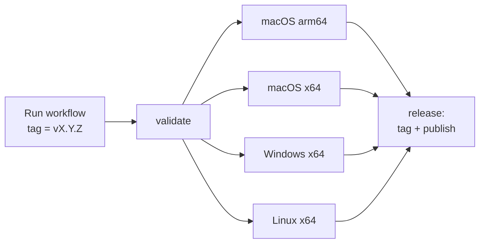

# Releasing

Releases are cut by hand from GitHub Actions. **Pushing a tag does nothing**: the **Release** workflow creates the tag itself, after every installer has built, so a tag always points to a commit that built on all platforms. This page mirrors `RELEASING.md` at the root of the repository.

## Cutting a Release

1. **Bump the version** in all three places (they must agree):

    | File | Field |
    |---|---|
    | `Cargo.toml` | `[workspace.package] version` (both crates inherit it) |
    | `package.json` | `"version"` |
    | `src-tauri/tauri.conf.json` | `"version"` |

    Run `cargo check` (or any cargo build) after the bump so that `Cargo.lock` picks up the new crate versions, then check that the three files agree:

    ```bash
    scripts/check-version.sh            # the three must agree
    scripts/check-version.sh v0.2.0     # ...and must equal the tag you plan to use
    ```

2. **Merge to `main`** through a pull request. CI runs `check-version.sh` too, so a partial bump fails the pull request.

3. **Run the workflow**: GitHub → **Actions** → **Release** → **Run workflow**:
    - *Use workflow from*: `main`
    - **tag**: `v` + the version, for example `v0.2.0`
    - **prerelease**: tick it for a pre-release (it is then not marked "Latest")

4. **Wait for the run** (about 20–30 minutes). When it is green, the release is live at `https://github.com/luksgrin/CytoFlow.rs/releases/tag/<tag>`.

If a run fails, nothing is tagged or published. Fix the problem on `main` and run the workflow again with the same tag.

!!! warning "Tag pushed but release not published"
    The one exception: if the tag was pushed but publishing the release then failed, the tag now blocks a re-run. Check that no release exists for it, delete the tag, and run the workflow again:
    ```bash
    git push --delete origin <tag>
    ```

## What Validation Enforces

The first job (`validate`) stops the run before anything is built if:

- the workflow is not run from `main`;
- the tag does not match `^v[0-9]+\.[0-9]+\.[0-9]+(-[0-9A-Za-z.]+)?$`;
- the tag has a pre-release suffix that is not a number from 0 to 65535. The Windows MSI bundler (WiX) only accepts numeric pre-release identifiers, so use `v0.2.0-1`, not `v0.2.0-rc.1`;
- the tag is not exactly `v` + the version in `Cargo.toml`, `package.json` and `src-tauri/tauri.conf.json` (the error names each file that does not match);
- the tag already exists on the remote (`git ls-remote --tags`);
- a GitHub release with that tag already exists (`gh release view`).

So **one tag can never be released twice**. To ship a fix, bump the version. The final job checks the tag and the release again just before tagging, in case either appeared while the builds ran.

## What the Workflow Does

1. **validate**: the checks above, on the commit the run was started from.

2. **build**, in parallel, all on that commit (`cargo tauri build --target … --bundles …`):

    | Runner | Target | Bundles |
    |---|---|---|
    | `macos-15` | `aarch64-apple-darwin` | `app,dmg` |
    | `macos-15` (cross-compiled) | `x86_64-apple-darwin` | `app,dmg` |
    | `windows-latest` | `x86_64-pc-windows-msvc` | `msi,nsis` |
    | `ubuntu-22.04` | `x86_64-unknown-linux-gnu` | `deb,appimage` |

    `scripts/collect-bundles.sh` copies each installer to its release name, so the asset names do not depend on Tauri's naming rules.

3. **release**: checks that the asset list is exactly as expected, creates the annotated tag (`git tag -a <tag>`) on the validated commit, pushes it, then publishes the GitHub release. The release notes list the per-platform downloads, the install instructions (including the Gatekeeper and SmartScreen steps), and the changes since the previous tag (generated by GitHub).



### Release assets

For version `X.Y.Z`:

| Asset | Platform |
|---|---|
| `CytoFlow_X.Y.Z_aarch64.dmg` | macOS, Apple Silicon |
| `CytoFlow_X.Y.Z_x64.dmg` | macOS, Intel |
| `CytoFlow_X.Y.Z_x64_en-US.msi` | Windows x64, MSI |
| `CytoFlow_X.Y.Z_x64-setup.exe` | Windows x64, NSIS installer (per-user, no administrator rights) |
| `CytoFlow_X.Y.Z_amd64.deb` | Linux x64, Debian / Ubuntu (depends on `libwebkit2gtk-4.1-0` and `libgtk-3-0`) |
| `CytoFlow_X.Y.Z_amd64.AppImage` | Linux x64, portable |
| `source.tar.gz` | `git archive` of the tagged commit |

The build artifacts are also kept on the workflow run for 7 days (`bundle-<target-triple>`).

The builds are **not code-signed or notarised**. Users have to bypass Gatekeeper (`xattr -cr /Applications/CytoFlow.app`, or right-click → Open, or System Settings → Privacy & Security → Open Anyway) and SmartScreen (More info → Run anyway); see the [Installation Guide](installation.md). The release notes explain this too.

## Continuous Integration

`.github/workflows/ci.yml` runs on every push to `main` and every pull request to `main`:

- **Frontend**: `scripts/check-version.sh`, `npm ci`, `npm run typecheck`, `npm run build`
- **Engine** (Ubuntu): fetches the large public test fixtures with `scripts/fetch-testdata.sh` (cached in `testdata/large`, keyed on the script's contents), then `cargo test -p cytoflow-core` and `cargo clippy -p cytoflow-core -p cytoflow --all-targets -- -D warnings`
- **Compile app** on Ubuntu 22.04, macOS and Windows: `cargo build -p cytoflow` (no installers)

Cargo builds use `--locked`, so commit `Cargo.lock` changes. To add a large fixture, edit `scripts/fetch-testdata.sh`; editing it also refreshes the CI cache.

## Documentation

The documentation is deployed separately, by `.github/workflows/docs.yml`; see [Deploying the docs](DEPLOYMENT.md).
