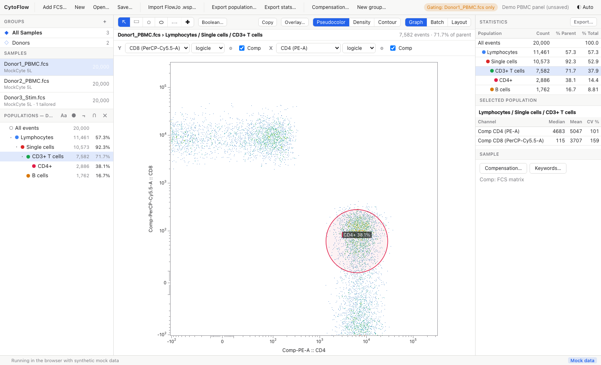
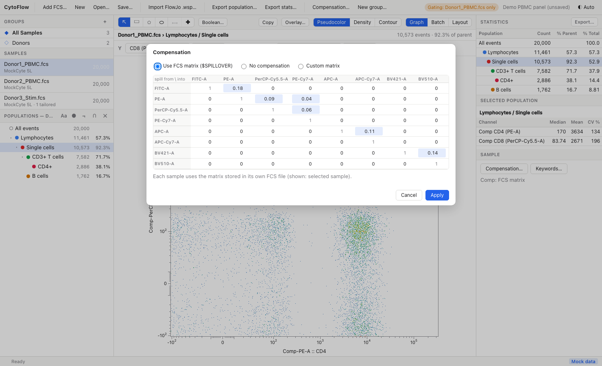

# The Graph Window

The centre of the main window plots the selected population of the selected sample. Its header holds the gate tools, the plot options and the view switch (**Graph** / **Batch** / **Layout**); below the header are the population path, the event counts and the axis controls.

## Header and Counts

The line under the header shows the sample and the population path, for example `Donor1_PBMC.fcs › Lymphocytes / Single cells / CD3+ T cells`, and on the right the number of events in the population together with its parent population's count and the percentage of parent.

## Choosing Channels

The **Y** and **X** controls each have a channel menu listing every parameter of the sample. Channels with a stain name (`$PnS`) are shown as `stain (channel)`, for example `CD4 (PE-A)`.

- Choose **Histogram** at the top of the **Y** menu to switch to a one-dimensional histogram of the X channel; choose a channel again to return to a 2-D plot.
- The axes you last used are remembered per sample and saved in the workspace.

## Axis Scales

Each axis has a scale menu. Every scale maps the instrument range onto a display range of about 0 to 1, and gates are stored in that display space, so **changing a scale re-maps the existing gates** on that channel: a gate keeps selecting the same events, it is only drawn differently.

| Scale | Use it for | Parameters (⚙) |
|---|---|---|
| **linear** | Scatter (FSC/SSC) and Time | **T** top of scale, **A** offset below zero |
| **log** | Uncompensated fluorescence without negative values | **T** top of scale, **M** decades |
| **asinh** | Fluorescence, mass cytometry | **T** top of scale, **M** decades, **A** extra negative decades |
| **logicle** | Compensated fluorescence (default for fluorescence channels) | **T** top of scale, **W** linear width in decades, **M** decades, **A** extra negative decades |
| **biex** | FlowJo's biexponential scale (for workspaces coming from FlowJo) | **T** top of scale, **Width basis** (≤ 0, e.g. −100), **Pos** positive decades, **Neg** extra negative decades |

The scale formulas follow Gating-ML 2.0: linear `(x + A) / (T + A)`, log `log10(x / T) / M + 1`, the Gating-ML arcsinh, and the logicle of Parks, Roederer & Moore (2006). The `biex` scale reproduces FlowJo's biexponential display (verified against a table exported by FlowJo, see [Validation](../validation.md)).

### Defaults

When you choose a scale, its parameters are estimated from the plotted sample:

- **T** is the channel's range (`$PnR`), or 262144 if the file does not give one;
- **M** (decades) is 4.5;
- for **logicle**, **W** is estimated from the 5th percentile of the channel's negative values, as recommended by Parks et al. (`W = (M − log10(T / |r|)) / 2`), or 0.5 if there are fewer than 10 negative events;
- for **biex**, width basis −100, 4.5 positive decades, no extra negative decades.

New samples start with **linear** on scatter and Time channels and **logicle** on everything else.

### Editing parameters

Click ⚙ next to the scale menu to open the parameter popover. Type new values and click **Apply** (or press **Enter**); **Defaults** re-estimates them from the data.

### Per-sample scales

With a **sample** selected, scale changes apply to that sample only (an override). With a **group** selected, they change the workspace default, which every sample without an override uses. Choosing the default scale for a sample removes its override.

Tick marks are placed at decades (`10²`, `10³`, …, and their negatives on logicle / asinh / biex axes) with minor ticks in between.

## Compensation

Each axis has a **Comp** checkbox. When ticked, the plot (and any gate you draw on it) uses compensated values; the axis label then reads `Comp-<channel>`. Fluorescence channels are compensated by default when a matrix is active; scatter and Time channels never are. The checkbox is disabled when compensation is off.

Choose the compensation source with **Compensation…** (toolbar or right column):

- **Use FCS matrix ($SPILLOVER)**: each sample uses the spillover matrix stored in its own FCS file (`$SPILLOVER`, `SPILL`, `$COMP`). Disabled if the file has none.
- **No compensation**: compensated axes are disabled.
- **Custom matrix**: one matrix applied to every sample. Editing any cell of the grid switches to this mode. Rows are the fluorochromes that spill, columns the detectors they spill into; off-diagonal non-zero cells are highlighted.

Compensated values are computed as `raw · S⁻¹`, where `S` is the spillover matrix. The current source is shown under the right column's **Compensation…** button.

## Plot Types

For 2-D plots, choose one of:

- **Pseudocolor**: every event as a dot coloured by the local density (blue = sparse, red = dense). Up to 60,000 events are drawn (evenly sub-sampled); the density colouring always uses every event
- **Density**: a binned density map
- **Contour**: density contour lines

Histograms are drawn as a filled outline of event counts over 256 bins. The plot type is disabled while an overlay is active.

## Zoom and Pan

| Action | Gesture |
|---|---|
| Zoom in / out around the cursor | Mouse wheel (or two-finger scroll / pinch on a trackpad) |
| Pan | Right-click and drag, or hold ++space++ and drag with the left button |
| Reset the view | Press **0** |

Zooming only changes what part of the display range you see: it does not change the axis scale, the gates or the statistics. You can draw and edit gates while zoomed in, which helps with small populations.

## Showing Parent Events

When you are looking at a sub-population, tick **Show parent events** to draw, in grey underneath, the events of the parent population that are *not* in the current population. This shows where the current gate cut the parent, like the "show excluded points" option of the old Flow Cytometry Analyzer.

## Overlays

Click **Overlay…** to draw several populations and/or samples on the same axes:

1. Tick the populations (of the plotted sample's tree) and the samples to show. Every ticked population is drawn for every ticked sample; the current sample and population are always included
2. Click **Apply**

Up to 12 series are drawn, each in its own colour with a legend. An overlay bar appears above the plot:

- for 2-D plots, choose **Contours** or **Dots**;
- for histograms, choose the normalisation: **% of max** (each curve scaled to its own maximum), **% of total** (fraction of the series' events) or **Count** (raw counts).

**Edit…** reopens the picker; **Clear** (or **Remove overlay** in the picker) returns to a single plot. The overlay selection is saved in the workspace.

## Copying a Plot

Click **Copy** to copy the current plot, including its gates, axes and labels, to the clipboard as a PNG image, ready to paste into a document or slide. If the clipboard is not available, a save dialog offers to write the PNG to a file instead.

For publication figures with several panels, use the [layout editor](layout.md), which exports PNG and SVG.

## Themes

The theme button at the right end of the toolbar cycles through **Auto** (follows the operating system's light / dark setting), **Light**, **Dim** and **Dark**. The choice is remembered between sessions. Plots, gate labels and the batch view follow the theme; layout pages are always rendered on white paper.
