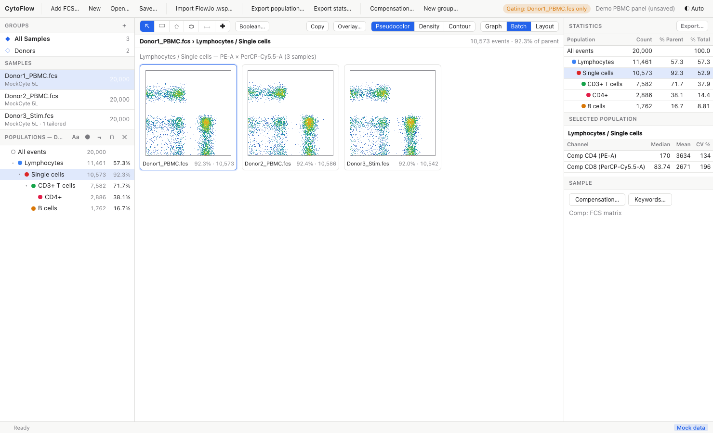
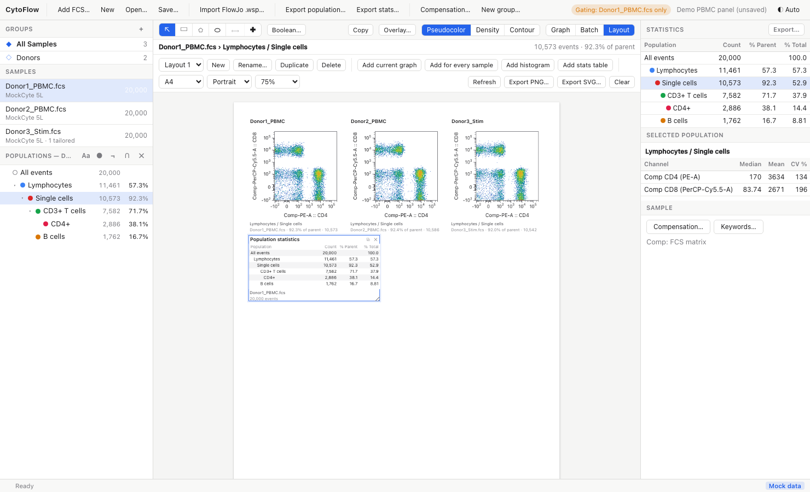

# Layouts and Batch View

The view switch in the graph header (**Graph** / **Batch** / **Layout**) changes what the centre of the window shows.

## Batch View

**Batch** shows the current plot (same X and Y channels, scales, population and plot type) for every sample as a grid of small plots, with the child gates drawn on each. Under each plot are the sample name and the population's % of parent and count.

- With a **group** selected, only its members are shown
- Samples whose FCS file is missing show "Not loaded"; samples that do not have the current population (for example a gate that exists only in another sample's tree) show "No such gate in this sample"
- Click a plot to open that sample in the graph window

The batch view updates whenever you change the axes, population, plot type or a gate, which makes it the quickest way to check that a group gate fits every sample before you tailor it.

## Layout Editor

**Layout** opens a page editor for figures and reports. A layout is a printable page (A4 or Letter, portrait or landscape) holding panels; panels re-render from the live data, so they follow gate edits, scale changes and compensation.

### Layouts of a workspace

A workspace can hold several named layouts. The bar at the top of the editor has:

- the **layout menu**, to switch between layouts
- **New**, **Rename…**, **Duplicate** and **Delete**

Layouts are saved in the workspace file together with the gates. Before the workspace has been saved to a file, they are also kept as a draft in the application, so they survive a restart.

### Adding panels

| Button | Adds |
|---|---|
| **Add current graph** | The graph window's plot: sample, population, X/Y channels and plot type |
| **Add for every sample** | One plot per sample with the current axes and population, arranged in a grid below the existing panels (3 columns in portrait, 4 in landscape) |
| **Add histogram** | A histogram of the current X channel |
| **Add stats table** | The population statistics table of the current sample |

Each plot panel shows its child gates with their percentages, and a caption with the population path, sample name, % of parent and count.

### Arranging panels

- **Drag** a panel to move it; drag the corner grip to resize it
- Click the title to edit it (an empty title shows the default, the sample or population name)
- **⧉** duplicates a panel, **✕** removes it; **Delete** / **Backspace** removes the selected panel
- Choose the page size (**A4** / **Letter**), orientation (**Portrait** / **Landscape**) and on-screen zoom (50 % to 125 %)
- **Refresh** re-reads all panels from the current data; **Clear** removes every panel

### Exporting a layout

- **Export PNG…** writes the page as a PNG image at twice the screen resolution (about 192 dpi), suitable for slides and documents
- **Export SVG…** writes the page as an SVG vector image, which you can edit in Inkscape, Illustrator or Affinity Designer and scale without loss

Pages are always rendered on a white background, whatever the application theme.
